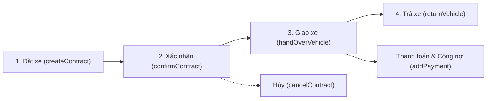

# Hệ Thống Quản Lý Cho Thuê Xe (Vehicle Rental Management)

Dự án quản lý cho thuê xe được xây dựng bằng **Node.js** (chuẩn ES Modules), kết nối cơ sở dữ liệu **MySQL** thông qua **Prisma ORM 7**, cùng bộ kiểm thử tự động toàn diện bằng **Jest**.

---

## 📌 Mục Lục
1. [Giới Thiệu](#-giới-thiệu)
2. [Công Nghệ Sử Dụng](#-công-nghệ-sử-dụng)
3. [Cấu Trúc Thư Mục](#-cấu-trúc-thư-mục)
4. [Yêu Cầu Hệ Thống](#-yêu-cầu-hệ-thống)
5. [Hướng Dẫn Cài Đặt & Cấu Hình](#-hướng-dẫn-cài-đặt--cấu-hình)
6. [Hướng Dẫn Sử Dụng & Chạy Dự Án](#-hướng-dẫn-sử-dụng--chạy-dự-án)
7. [Quy Trình Nghiệp Vụ Cốt Lõi](#-quy-trình-nghiệp-vụ-cốt-lõi)
8. [Bộ Kiểm Thử Tự Động (Unit Test)](#-bộ-kiểm-thử-tự-động-unit-test)
9. [Xử Lý Một Số Lỗi Thường Gặp](#-xử-lý-một-số-lỗi-thường-gặp)

---

## 📖 Giới Thiệu

Hệ thống cung cấp giải pháp quản lý toàn diện quy trình cho thuê xe:
- Quản lý thông tin xe, tình trạng sẵn sàng, bảo dưỡng.
- Quản lý hồ sơ khách hàng và nhân viên.
- Quản lý vòng đời hợp đồng thuê xe: từ lúc đặt lịch, xác nhận, bàn giao xe cho đến khi trả xe.
- Quản lý thanh toán, theo dõi công nợ hợp đồng.
- Báo cáo và thống kê: Doanh thu theo tháng, thống kê trạng thái xe, chi phí bảo trì.

---

## 🛠 Công Nghệ Sử Dụng

- **Ngôn ngữ & Nền tảng:** Node.js (hỗ trợ chuẩn `import / export` - ES Modules).
- **Cơ sở dữ liệu:** MySQL / MariaDB (Port mặc định: `3306`).
- **ORM (Object Relational Mapping):** Prisma ORM 7 (`@prisma/client`, `@prisma/adapter-mariadb`).
- **Kiểm thử tự động (Unit Test):** Jest (sử dụng kỹ thuật Mock, kiểm thử độc lập không cần MySQL thật).
- **Thư viện hỗ trợ:** `dotenv` (quản lý biến môi trường).

---

## 📂 Cấu Trúc Thư Mục

```text
cong_nghe_phan_mem/
├── .env                  # Tệp cấu hình chuỗi kết nối MySQL bí mật
├── .env.example          # Tệp mẫu hướng dẫn cấu hình môi trường
├── package.json          # Quản lý thư viện phụ thuộc và script chạy
├── prisma.config.ts      # Cấu hình Prisma 7 (Prisma CLI tự nhận)
├── .gitignore            # Bỏ qua .env, generated/, node_modules/
├── cauLenhSQL.txt        # Toàn bộ câu lệnh SQL thuần (DDL & DML)
├── README.md             # Tài liệu hướng dẫn sử dụng dự án
│
├── prisma/               # Cấu hình cơ sở dữ liệu Prisma
│   ├── schema.prisma     # Định nghĩa các bảng, cột và quan hệ
│   ├── seed.js           # Kịch bản nạp dữ liệu mẫu ban đầu
│   └── migrations/       # Lịch sử cập nhật cấu trúc database
│
├── generated/            # Mã nguồn Prisma Client tự động sinh ra
│
└── src/                  # Mã nguồn chính của ứng dụng
    ├── prismaClient.js   # Khởi tạo kết nối Prisma tới MySQL
    ├── db.js             # Kiểm tra kết nối cơ sở dữ liệu
    ├── chucnang.js       # Toàn bộ logic nghiệp vụ cốt lõi
    ├── demo.js           # Chương trình chạy thử nghiệm các chức năng
    │
    ├── crud/             # Tầng CRUD Thêm - Đọc - Sửa - Xóa 9 bảng
    │   ├── index.js      # Gom toàn bộ module CRUD
    │   ├── xe.js         # Thao tác bảng xe
    │   ├── khachHang.js  # Thao tác bảng khách hàng
    │   ├── nhanVien.js   # Thao tác bảng nhân viên
    │   ├── loaiXe.js     # Thao tác bảng loại xe
    │   ├── hopDong.js    # Thao tác bảng hợp đồng
    │   ├── thanhToan.js  # Thao tác bảng thanh toán
    │   ├── hoanTien.js   # Thao tác bảng hoàn tiền
    │   ├── baoTri.js     # Thao tác bảng bảo trì
    │   └── tinhTrangTraXe.js # Thao tác bảng tình trạng trả xe
    │
    └── tests/            # Bộ kiểm thử tự động
        ├── chucnang.test.js # 81 ca test nghiệp vụ & thống kê (Jest Mock)
        ├── crud.test.js     # 23 ca test tầng CRUD (Jest Mock)
        └── integration/
            └── chucnang.integration.js # 25 ca test trên MySQL thật (node:test)
```

---

## 💻 Yêu Cầu Hệ Thống

Trước khi bắt đầu, hãy đảm bảo máy tính của bạn đã cài đặt:
1. **Node.js**: Phiên bản **22.18 trở lên** (Prisma Client sinh ra file `.ts` và được import trực tiếp; Node thấp hơn sẽ lỗi). Kiểm tra: `node -v`.
2. **Hệ quản trị CSDL MySQL 8.0.16+ / MariaDB 10.2.1+** (để ràng buộc CHECK có hiệu lực): Cài đặt thông qua XAMPP, Laragon hoặc MySQL Community Server.
3. **Trình soạn thảo mã nguồn**: Visual Studio Code, Cursor, Windsurf,...

---

## ⚙️ Hướng Dẫn Cài Đặt & Cấu Hình

### Bước 1: Cài đặt các thư viện phụ thuộc
Mở terminal tại thư mục gốc của dự án và chạy:
```bash
npm install
```

### Bước 2: Tạo cơ sở dữ liệu trong MySQL
Khởi động MySQL (ví dụ: nhấn **Start** MySQL trong bảng điều khiển XAMPP).
Mở phần mềm quản lý (như phpMyAdmin, MySQL Workbench, DBeaver) và chạy lệnh tạo database:
```sql
CREATE DATABASE IF NOT EXISTS manager_vehicle_rent CHARACTER SET utf8mb4 COLLATE utf8mb4_unicode_ci;
```
*(Nếu muốn tạo bảng và dữ liệu mẫu bằng SQL thuần, bạn có thể copy nội dung trong tệp `cauLenhSQL.txt` để thực thi).*

### Bước 3: Cấu hình tệp `.env`
Tạo hoặc mở tệp `.env` tại thư mục gốc và điền chuỗi kết nối MySQL của bạn theo mẫu:
```env
DATABASE_URL="mysql://<user>:<password>@<host>:<port>/<ten_database>"
```
**Ví dụ thực tế:**
```env
DATABASE_URL="mysql://root:<mat_khau>@localhost:3306/manager_vehicle_rent"
```
*   `root`: Tên tài khoản MySQL.
*   `<mat_khau>`: Mật khẩu tài khoản MySQL của bạn (nếu không có mật khẩu thì để trống: `root:@localhost...`). **Không commit file `.env`** (đã nằm trong `.gitignore`).
*   `3306`: Cổng kết nối MySQL.
*   `manager_vehicle_rent`: Tên database vừa tạo ở Bước 2.

### Bước 4: Đồng bộ Prisma và nạp dữ liệu mẫu
1. Sinh mã nguồn Prisma Client:
```bash
npx prisma generate
```
2. Tạo database kiểm thử riêng, ví dụ `manager_vehicle_rent_test`, và giữ `DATABASE_URL` trong `.env` trỏ tới database ứng dụng khác.
3. Trong một terminal riêng, đặt `TEST_DATABASE_URL`, đặt `DATABASE_URL` tạm thời bằng URL kiểm thử, rồi áp dụng migration:
```cmd
set TEST_DATABASE_URL=mysql://root:<mat_khau>@localhost:3306/manager_vehicle_rent_test
set DATABASE_URL=%TEST_DATABASE_URL%
set ALLOW_DESTRUCTIVE_TEST_DB=YES
npx prisma migrate deploy
```
4. Mở terminal mới để `DATABASE_URL` được nạp lại từ `.env`; chỉ đặt URL kiểm thử và xác nhận thao tác phá hủy trước khi nạp dữ liệu mẫu:
```cmd
set TEST_DATABASE_URL=mysql://root:<mat_khau>@localhost:3306/manager_vehicle_rent_test
set ALLOW_DESTRUCTIVE_TEST_DB=YES
npm run seed
```
*(Tệp seed chỉ chạy trên database riêng có token `test` trong tên và khác database ứng dụng. Tệp sẽ xóa dữ liệu cũ trong 9 bảng trước khi tạo lại dữ liệu mẫu.)*

---

## 🚀 Hướng Dẫn Sử Dụng & Chạy Dự Án

### 1. Kiểm tra kết nối cơ sở dữ liệu
Chạy tệp `src/db.js` để kiểm tra Node.js đã kết nối được tới MySQL chưa:
```bash
node src/db.js
```
*   **Thành công:** Màn hình sẽ thông báo `Kết nối MySQL thành công!` và in ra danh sách dữ liệu bảng `bao_tri`.
*   **Thất bại:** Kiểm tra lại tài khoản, mật khẩu hoặc cổng port trong file `.env`.

### 2. Chạy thử nghiệm các chức năng (Demo)
Chạy tệp `src/demo.js` để xem chương trình mô phỏng các hoạt động thực tế:
```bash
node src/demo.js
```
Chương trình sẽ tự động truy vấn và in ra các bảng kết quả:
*   Danh sách các xe đang ở trạng thái sẵn sàng cho thuê (`SAN_SANG`).
*   Tìm kiếm khách hàng theo tên.
*   Xem chi tiết hợp đồng và các lần thanh toán.
*   Thống kê số lượng xe theo trạng thái.
*   Báo cáo doanh thu theo 12 tháng trong năm.
*   Kiểm tra số dư/công nợ của hợp đồng.

---

## 🔄 Quy Trình Nghiệp Vụ Cốt Lõi

Toàn bộ logic nghiệp vụ được viết trong tệp `src/chucnang.js`:



1. **Tìm xe trống (`findAvailableVehicles`)**: Lọc những xe không bị trùng lịch với hợp đồng khác trong khoảng thời gian khách chọn.
2. **Đặt xe (`createContract`)**: Kiểm tra ngày hợp lệ và ngày trả sau ngày thuê, khách hàng/nhân viên tồn tại, xe không bảo trì/ngừng hoạt động và không trùng lịch (khóa dòng xe khi kiểm tra). Nếu không truyền `tienThue` thì tự tính = số ngày (làm tròn lên) × `loai_xe.giaThueNgay`. Hợp đồng khởi tạo ở `CHO_XAC_NHAN`.
   *Quy tắc đặt xe: xe `DANG_THUE` vẫn đặt được cho khoảng thời gian không trùng lịch (đặt trước); chỉ xe bảo trì/ngừng hoạt động bị chặn.*
3. **Xác nhận (`confirmContract`)**: Chuyển hợp đồng từ `CHO_XAC_NHAN` sang `DA_XAC_NHAN`.
4. **Giao xe (`handOverVehicle`)**: Chuyển trạng thái xe và hợp đồng sang `DANG_THUE`; từ chối nếu xe đang bảo trì hoặc đang được khách khác thuê chưa trả.
5. **Trả xe (`returnVehicle`)**: Tính **phí trả trễ** lưu vào `hop_dong.phiTraTre` (trễ quá 60 phút ân hạn: số giờ trễ làm tròn lên × giá thuê ngày/24 × 1,5). Kiểm tra nhiên liệu 0–100 và số km không nhỏ hơn km hiện tại của xe; ghi `tinh_trang_tra_xe` (mỗi hợp đồng chỉ 1 bản ghi), cập nhật xe về `SAN_SANG` và hợp đồng thành `DA_TRA`.
6. **Hủy hợp đồng (`cancelContract`)**: Chỉ cho phép hủy khi xe chưa được bàn giao. Nếu khách đã thanh toán thì tự tạo khoản **hoàn tiền** (bảng `hoan_tien`): hợp đồng chưa xác nhận hoặc hủy trước giờ thuê ≥ 24h hoàn 100%; hủy muộn hơn hoàn 70% (giữ 30% phí hủy). Trả về `{ hopDong, hoanTien }`.
7. **Thanh toán (`addPayment`, `getContractBalance`)**: Công nợ = tiền thuê + phí trả trễ − (đã thanh toán − đã hoàn); hợp đồng đã hủy không còn nợ. Khóa hợp đồng khi tính công nợ; từ chối số tiền `<= 0`, phương thức không hợp lệ, hợp đồng đã hủy, hoặc số tiền vượt quá số còn nợ.
8. **Bảo trì (`startMaintenance`, `completeMaintenance`)**: Chuyển xe sang `DANG_BAO_TRI` (từ chối nếu xe đang thuê/đang bảo trì/ngừng hoạt động hoặc có hợp đồng sắp tới); khi hoàn thành, chỉ trả xe về `SAN_SANG` nếu không còn phiếu bảo trì mở khác.

### Xe trả trễ và hợp đồng kế tiếp

- **Thời gian đệm 4 giờ** (`TURNAROUND_BUFFER_HOURS`): hai hợp đồng liên tiếp của một xe phải cách nhau ≥ 4 giờ (vệ sinh/kiểm tra xe). Áp dụng cho `findAvailableVehicles`, `createContract`, `reassignVehicle`.
- **Cảnh báo sớm — `getAtRiskContracts()`**: liệt kê hợp đồng sắp tới (chờ xác nhận/đã xác nhận) mà xe chưa kịp sẵn sàng vì hợp đồng đang thuê đã/sắp quá hạn (tính cả đệm). Mỗi dòng có `quaHan`, `soGioTre`, `xeSanSangDuKien`.
- **Đổi xe — `reassignVehicle(maHD, maXeMoi, { nangCapMienPhi })`**: chỉ cho hợp đồng chưa giao; xe mới phải sẵn sàng, không trùng lịch (kể cả đệm), số chỗ không ít hơn xe cũ; xe hạng đắt hơn chỉ được đổi khi `nangCapMienPhi = true`. Tiền thuê giữ nguyên.
- **Hủy do lỗi công ty — `cancelContract(maHD, { loiCongTy: true })`**: luôn hoàn 100%, không áp dụng phí hủy muộn.
- Xe quá hạn vẫn bị chặn giao cho khách mới (`handOverVehicle`); nhân viên xử lý theo thứ tự: đổi xe cùng loại → dời lịch (thỏa thuận với khách) → hủy hoàn 100%. Phí trả trễ của khách trước vẫn được thu khi `returnVehicle`.

> Các tỷ lệ/thời hạn phí trả trễ và hoàn tiền nằm ở hằng số đầu `src/chucnang.js` (`LATE_GRACE_MINUTES`, `LATE_FEE_RATE`, `FULL_REFUND_HOURS`, `LATE_CANCEL_REFUND_RATE`, `TURNAROUND_BUFFER_HOURS`), cần xác nhận lại với yêu cầu thực tế.
>
> **Chưa làm:** hoàn tiền thủ công ngoài luồng hủy, hoàn khi trả xe sớm, phân quyền/UI/API.

---

## 🧪 Bộ Kiểm Thử Tự Động (Unit Test)

Dự án trang bị bộ Unit Test chuẩn chỉ với **Jest**, sử dụng kỹ thuật **Mock Prisma** (kiểm thử hoàn toàn tách biệt, không phụ thuộc và không làm thay đổi dữ liệu trong MySQL thật).

### 1. Unit test (Jest + Mock Prisma, không cần MySQL)
```bash
npm test
```
*   `src/tests/chucnang.test.js`: **91** ca (UT01–UT91) cho nghiệp vụ và thống kê.
*   `src/tests/crud.test.js`: **23** ca (CR00–CR14; mỗi module 1 ca cho 5 hàm chuẩn + các hàm lọc riêng) cho toàn bộ tầng CRUD của 9 bảng.
*   `src/tests/testDatabaseSafety.test.js`: **10** ca kiểm tra rào an toàn trước thao tác xóa dữ liệu.
*   Tổng theo các file hiện tại: **124** ca.
*   **Bao phủ:** kiểm tra hợp lệ dữ liệu, ràng buộc trạng thái, giao dịch và cập nhật liên bảng, phí trả trễ, hoàn tiền, thời gian đệm, đổi xe, cảnh báo xe trả trễ, các hàm lọc/tìm kiếm của CRUD.
*   Vì chạy trên mock nên **không bắt được** lỗi SQL thật hay tranh chấp dữ liệu thật; việc khóa dòng chỉ được kiểm tra là *có gọi*. Phần đó do test tích hợp bên dưới đảm nhận.

### 2. Test tích hợp trên MySQL thật (`node:test`, 26 ca)
Kiểm tra những thứ mock không làm được: nhiều người đặt cùng một xe / thanh toán cùng lúc, ràng buộc CHECK/UNIQUE/RESTRICT của DB, vòng đời hợp đồng end-to-end, và **tính nhất quán của dữ liệu mẫu** (`prisma/seed.js`).

> ⚠️ File này **xóa sạch dữ liệu 9 bảng**. Bắt buộc dùng database riêng có chữ `test` trong tên; nếu không, test sẽ dừng ngay.
> Cần đặt `ALLOW_DESTRUCTIVE_TEST_DB=YES`; test cũng từ chối nếu `TEST_DATABASE_URL` trỏ cùng host, port và database với `DATABASE_URL`.

Tạo database test và chạy migration trong một terminal riêng:
```cmd
mysql -u root -p -e "CREATE DATABASE manager_vehicle_rent_test CHARACTER SET utf8mb4 COLLATE utf8mb4_unicode_ci;"
set TEST_DATABASE_URL=mysql://root:<mat_khau>@localhost:3306/manager_vehicle_rent_test
set DATABASE_URL=%TEST_DATABASE_URL%
set ALLOW_DESTRUCTIVE_TEST_DB=YES
npx prisma migrate deploy
```

Sau đó mở terminal mới. Đảm bảo `DATABASE_URL` được nạp từ `.env` và khác database test; không đặt `DATABASE_URL` thành `TEST_DATABASE_URL` trong terminal này:
```cmd
set TEST_DATABASE_URL=mysql://root:<mat_khau>@localhost:3306/manager_vehicle_rent_test
set ALLOW_DESTRUCTIVE_TEST_DB=YES
npm run test:integration
```
(Có thể tạo database bằng MySQL Workbench thay cho lệnh `mysql`.) Nếu không đặt `TEST_DATABASE_URL`, toàn bộ test tích hợp tự động bị bỏ qua.

---

## ❓ Xử Lý Một Số Lỗi Thường Gặp

### 1. Lỗi PowerShell `PSSecurityException` khi chạy `npm`
*   **Hiện tượng:** `File C:\Program Files\nodejs\npm.ps1 cannot be loaded because running scripts is disabled...`
*   **Nguyên nhân:** Windows chặn thực thi script trong PowerShell.
*   **Cách xử lý 1:** Chạy lệnh thông qua CMD:
    ```bash
    cmd /c npm test
    ```
*   **Cách xử lý 2 (Khuyến nghị):** Mở PowerShell với quyền Administrator và chạy lệnh mở khóa:
    ```powershell
    Set-ExecutionPolicy -Scope CurrentUser -ExecutionPolicy RemoteSigned
    ```

### 2. Lỗi kết nối CSDL `Access denied for user...` hoặc `ECONNREFUSED`
*   Đảm bảo dịch vụ MySQL đang được bật.
*   Kiểm tra kỹ lại mật khẩu trong file `.env`. Nếu bạn dùng XAMPP mặc định không có mật khẩu, hãy để:
    ```env
    DATABASE_URL="mysql://root:@localhost:3306/manager_vehicle_rent"
    ```

### 3. Lỗi không tìm thấy Prisma Client (`Cannot find module .../client.ts`) hoặc lỗi import `.ts`
*   Kiểm tra `node -v` ≥ 22.18.
*   Chạy lại lệnh sinh mã của Prisma:
    ```bash
    npx prisma generate
    ```

---

*Chúc bạn học tập và phát triển dự án thành công!*

